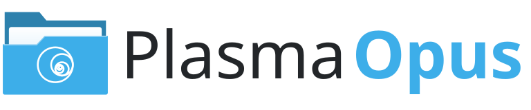
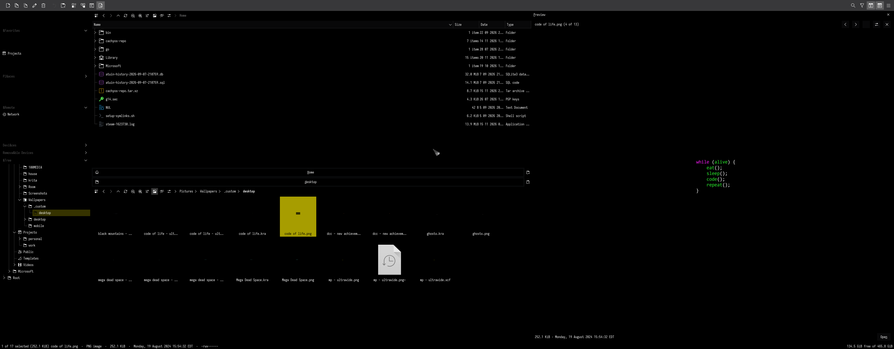

# Plasma Opus

<p align="center">
  <picture>
    <source media="(prefers-color-scheme: dark)" srcset="src/app/branding/plasma-opus-logo-dark.svg">
    
  </picture>
</p>

<p align="center">
  <strong>A dual-pane file manager for KDE Plasma</strong><br>
  Power-user workflows with native KDE file operations, Places and settings.
</p>

<p align="center">
  <a href="https://github.com/mikepadiernos/plasma-opus/releases/latest"></a>
  
  
  
  
  <a href="https://github.com/users/mikepadiernos/projects/3"></a>
</p>

<p align="center">
  <a href="#build-and-run">🚀 Get started</a> ·
  <a href="#features">✨ Features</a> ·
  <a href="#screenshots">📸 Screenshots</a> ·
  <a href="#customize-the-interface">🎛️ Customize</a> ·
  <a href="#safety-and-limitations">🛡️ Safety</a> ·
  <a href="docs/ROADMAP.md">🗺️ Roadmap</a> ·
  <a href="docs/README.md">📚 Docs</a>
</p>



> [!NOTE]
> The latest published MVP is
> [v0.2.0](https://github.com/mikepadiernos/plasma-opus/releases/tag/v0.2.0).
> Since that release, `main` has gained workspaces (M15–M16), themes (M17–M18),
> branding (M19–M20), advanced search with its settings (M21–M22), native
> tagging with its settings (M23–M24) and Yazi mode with its settings
> (M25–M26); see the
> [roadmap](docs/ROADMAP.md#at-a-glance) for status.

## Features

New windows start with stacked panes, visible tab bars and a right-side
preview. Pane navigation starts linked, and activating most files opens a
preview. Both behaviours can be changed in Preferences.

- 🗂️ **Browse:** side-by-side or stacked panes with tabs, history and session
  restoration. Details, Icons, Compact, Card or flat views, with filtering and
  per-folder formats.
- 📦 **Manage files:** KDE file actions, queued transfers, undo, batch rename,
  duplicate finding and listing export. Browse and manage archives, including
  AES-encrypted ZIP creation and protected extraction, checksums and split
  files.
- 🔀 **Compare and sync:** compare files or folders and preview per-item actions
  before synchronizing local folders.
- 🔎 **Search and automate:** search local folders or a Baloo index from the
  toolbar or an embedded search panel, combine name, path, type, size, date and
  content criteria with AND, OR and NOT, save searches and collections, and
  preview scripts or commands before running them.
- 🔖 **Tag:** opt-in [tag libraries](docs/tagging.md) in existing folders, with
  hierarchical tags, groups, text and date fields, a tag panel, tag and
  embedded-metadata search criteria, metadata import, export and restore, and
  a Tagging page in Preferences. Files are never moved or renamed.
- 🧱 **Yazi mode:** an optional, per-pane [column layout](docs/yazi-mode.md)
  inspired by the Yazi terminal file manager, with parent, current and preview
  columns and keyboard-first navigation, including optional Vim-style keys,
  and a Yazi Mode page in Preferences.
- 🖼️ **Preview and edit:** preview documents and media, use the image gallery,
  edit text with drafts and edit supported media metadata. Preview, text and
  metadata panels can be placed beside or below the panes.
- 🧭 **Workspaces:** named workspaces with assigned locations, saved layouts,
  explicit pane and tab snapshots, workspace-scoped search, a startup choice,
  recovery options and profile import or export.
- 🎨 **Themes:** app-local colour schemes, accents and pane tints, blur,
  opacity and corner radius, dividers and coloured tree lines, folder colour
  rules, fonts, spacing and motion. Save them as theme profiles with an
  optional stylesheet, or let each workspace apply its own appearance. Plasma's
  appearance remains the default.
- 💻 **Terminal:** embed Konsole below or beside the panes, with optional
  active-folder following. Hiding the panel retains its sessions.
- 🌐 **Languages:** translation catalogues, right-to-left layouts, Jalali dates
  and regional format overrides; see the [translation guide](po/README.md).

## Screenshots

Captured headless in the dev container with synthetic demo files, so KWin
decorations, blur and the Plasma theme are absent. See the
[screenshot notes](docs/screenshots/README.md).

| Dual panes                     | Card view                        |
| ------------------------------ | -------------------------------- |
| [![Dual panes][s1]][s1]        | [![Card view][s9]][s9]           |
| **Image preview**              | **Code preview**                 |
| [![Image preview][s2]][s2]     | [![Code preview][s3]][s3]        |
| **Embedded terminal**          | **Image gallery**                |
| [![Embedded terminal][s4]][s4] | [![Image gallery][s5]][s5]       |
| **Batch rename**               | **Content chart**                |
| [![Batch rename][s6]][s6]      | [![Content chart][s7]][s7]       |
| **Theme settings**             | **Branding settings**            |
| [![Theme settings][s8]][s8]    | [![Branding settings][s10]][s10] |

[s1]: docs/screenshots/dual-pane.png
[s2]: docs/screenshots/image-preview.png
[s3]: docs/screenshots/code-preview.png
[s4]: docs/screenshots/embedded-terminal.png
[s5]: docs/screenshots/image-gallery.png
[s6]: docs/screenshots/batch-rename.png
[s7]: docs/screenshots/content-chart.png
[s8]: docs/screenshots/settings-themes.png
[s9]: docs/screenshots/card-view.png
[s10]: docs/screenshots/settings-branding.png

## Build and run

**📋 Requirements** · A C++20 compiler, CMake 3.25+, Ninja, Qt 6.8+ with Jalali
calendar support, Extra CMake Modules, libarchive and KDE Frameworks 6.20+. See
`CMakeLists.txt` for the required components; Baloo development files optionally
enable indexed search.

**🔨 Build and test**

```bash
./install.sh --deps  # Print build and optional feature packages; does not install them
cmake -S . -B build -G Ninja -DCMAKE_BUILD_TYPE=Debug -DBUILD_TESTING=ON
cmake --build build
QT_QPA_PLATFORM=offscreen ctest --test-dir build --output-on-failure
./build/bin/opus-file-manager
```

**🐳 Dev container** · Without the Linux dependencies, for example on macOS, use
the headless Docker dev container. It extends the `plasma-impresario-dev` image
and is built automatically from a sibling `plasma-impresario` checkout, or from
`IMPRESARIO_DIR`:

```bash
tools/dev-container/run.sh sh -c 'cmake -S . -B build-container -G Ninja -DCMAKE_BUILD_TYPE=Debug && cmake --build build-container'
tools/dev-container/run.sh ctest --test-dir build-container --output-on-failure -j4
```

**📂 Arguments** · Pass folders or URLs as arguments: the first opens in the
active pane, the second in the other pane, and additional arguments in tabs in
the active pane. Without arguments, the configured startup or restored session
is used.

**📥 Install** · Run `./install.sh` for the current user; use
`./install.sh --help` for options. `./install.sh --default` also changes the
default folder handler. The installer uses `build-plasma` with tests disabled;
set `OPUSFM_BUILD_DIR` to choose another build tree. Uninstall using the same
build tree. The app icon, desktop entry and AppStream metadata are installed
with the application; file and action icons follow the active desktop theme.
See [branding](docs/BRANDING.md) for the logo and icon assets.

> [!TIP]
> If `build` was created before the project folder was renamed, use a fresh
> build directory for the manual build commands above.

**🧩 Optional integrations** · Baloo provides indexed search, Konsole provides
the embedded terminal, and ExifTool supports media metadata editing. See the
[caveats](docs/CAVEATS.md) for requirements and restrictions and the
[translation guide](po/README.md) for language setup.

## Customize the interface

- **🪟 Panes and panels:** Swap current tabs or whole pane sides, dim the
  inactive pane, and save or reset splitter sizes by orientation. Change
  combined panel section order, visibility and titles; embedded panel titles can
  be hidden separately from navigation-panel titles.
- **🧰 Toolbars:** Configure the main and pane toolbars and hamburger menu,
  choose button appearance and lock editing. Toolbar context menus provide
  editing and settings access; the main toolbar also retains KDE's toolbar
  options. Saved scripts and commands can become main-toolbar buttons; running
  them still requires preview and confirmation.
- **🏷️ Tabs and status:** Position tab bars per pane and layout, or keep them
  together between stacked panes. Show or hide close buttons and configure
  status-bar indicators and their order.
- **👁️ Views:** Enable the
  [file-list minimap](docs/CAVEATS.md#file-list-minimap) and set its width.
  Choose Information panel fields and their order, with optional hover
  information. Set a theme, light, dark or checkerboard background for
  transparent images without changing the image.
- **🎨 Appearance:** The Themes page sets app-local colours, effects, lines,
  views, folder colours, text and motion, and manages theme profiles
  ([M17](docs/ROADMAP.md#m17-themes),
  [M18](docs/ROADMAP.md#m18-theme-settings)). The Branding page turns the
  optional startup presentation on and chooses its logo
  ([M20](docs/ROADMAP.md#m20-branding-settings)).
- **💾 Backup:** Back up settings and window and panel layouts, or preview a
  restore that applies on the next launch. Review the
  [backup limitations](docs/CAVEATS.md#settings-backups) before sharing or
  relying on an archive.

> [!IMPORTANT]
> Path-filter, saved-search, collection, rename-preset and automation management
> changes take effect immediately, even if Preferences is cancelled. KDE File
> Associations changes shared desktop settings.

Preferences also include [tool defaults](docs/ROADMAP.md#m10-tools-settings),
[language and regional formats](docs/ROADMAP.md#m14-translation-settings) and
[workspace settings](docs/ROADMAP.md#m16-workspace-settings). Edit a
workspace's theme profile and appearance overrides in **View → Workspaces**.

## Safety and limitations

> [!WARNING]
> Back up existing `.mfm.json` files before editing: unsupported metadata may be
> discarded. Synchronization is not undoable and can leave partial results;
> automatic transfer overwrite can replace files without asking.

See [caveats and limitations](docs/CAVEATS.md) for restrictions and workarounds,
[reported bugs](docs/BUGS.md) for tracked issues, and [edge cases](docs/EDGE.md)
for possible scenarios that are not confirmed bugs.

## Documentation

|     | Guide                                                              | What it covers                                      |
| --- | ------------------------------------------------------------------ | --------------------------------------------------- |
| 📚  | [Documentation index](docs/README.md)                              | Design, plans, integrations and upstream references |
| 🗺️  | [Roadmap](docs/ROADMAP.md)                                         | Architecture, milestone status and planned features |
| 📋  | [Project board](https://github.com/users/mikepadiernos/projects/3) | Issue status from Backlog to Merged                 |
| ⏳  | [Pending tasks](docs/TODO.md)                                      | Blocked work and handoffs                           |
| ⚠️  | [Caveats](docs/CAVEATS.md)                                         | Limitations, dependencies and workarounds           |
| 🐞  | [Reported bugs](docs/BUGS.md)                                      | Bug reports and their status                        |
| 🧪  | [Edge cases](docs/EDGE.md)                                         | Possible scenarios worth testing                    |
| 🎨  | [Branding](docs/BRANDING.md)                                       | Name, logo, icons and startup presentation          |
| 📸  | [Screenshots](docs/screenshots/README.md)                          | Captured views and how they were made               |
| 🌐  | [Translations](po/README.md)                                       | Catalogues, languages and regional formats          |
