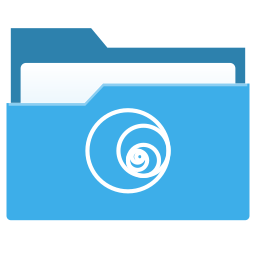

# Plasma Opus



**A dual-pane file manager for KDE Plasma**, combining power-user workflows
with native KDE file operations, Places and settings. Plasma Opus is built for
Linux with C++20, Qt 6 Widgets and KDE Frameworks 6.

**[Get started](#build-and-run)** · **[Explore features](#features)** ·
**[Customize](#customize-the-interface)** · **[Safety](#safety-and-limitations)** ·
**[Roadmap](docs/ROADMAP.md)** · **[Documentation](docs/README.md)**


> [!NOTE]
> The latest published MVP is
> [v0.2.0](https://github.com/mikepadiernos/plasma-opus-file-manager/releases/tag/v0.2.0).
> This README describes `main`, including fixes made after that release.

## Build and run

**Requirements:** a C++20 compiler, CMake 3.25+, Ninja, Qt 6.8+ with Jalali
calendar support, Extra CMake Modules, libarchive and KDE Frameworks 6.20+.
See `CMakeLists.txt` for required components. Baloo development files are
optional and enable indexed search.

```bash
./install.sh --deps  # Print build and optional feature packages; does not install them
cmake -S . -B build -G Ninja -DCMAKE_BUILD_TYPE=Debug -DBUILD_TESTING=ON
cmake --build build
QT_QPA_PLATFORM=offscreen ctest --test-dir build --output-on-failure
./build/bin/opus-file-manager
```

Pass folders or URLs to open them: the first goes to the active pane, the
second to the other pane, and additional arguments to tabs in the active pane.
Without arguments, the configured startup or restored session is used.

**Install:** run `./install.sh` for the current user, or `./install.sh --help`
for options. `./install.sh --default` also changes the default folder handler.
The installer uses `build-plasma` with tests disabled; set `OPUSFM_BUILD_DIR`
to select another build tree. Uninstall using the same build tree. The
application icon is installed with the app; file and action icons continue to
follow the active desktop theme.

If `build` was created before the project folder was renamed, use a fresh
build directory for the manual build commands above.

**Optional integrations:** Baloo provides indexed search, Konsole provides the
embedded terminal, and ExifTool supports media metadata editing. Consult the
[caveats](docs/CAVEATS.md) for requirements and restrictions and the
[translation guide](po/README.md) for language setup.

## Features

New windows start with stacked panes, visible tab bars and a right-side preview.
Pane navigation starts linked, and activating most files opens a preview.
Both behaviours can be changed in Preferences.

- **Browse:** Use side-by-side or stacked panes with tabs, history and session
  restoration. Choose details, icon, compact or flat views, with filtering
  and per-folder formats.
- **Manage files:** Use KDE file actions, queued transfers, undo, batch rename,
  duplicate finding and listing export. Browse and manage archives, including
  AES-encrypted ZIP creation and protected extraction, checksums and split files.
- **Compare and sync:** Compare files or folders and preview per-item actions
  before synchronizing local folders.
- **Search and automate:** Search local folders or a Baloo index, save searches
  and collections, and preview scripts or commands before running them.
- **Preview and edit:** Preview documents and media, use the image gallery,
  edit text and drafts, and edit supported media metadata. Preview, text and
  metadata panels can be placed beside or below the panes.
- **Terminal:** Embed Konsole below or beside the panes, with optional
  active-folder following. Hiding the panel retains its sessions.

## Customize the interface

- **Panes and panels:** Swap current tabs or whole pane sides, dim the inactive
  pane, and save or reset splitter sizes by orientation. Change combined panel
  section order, visibility and titles; embedded panel titles can be hidden
  separately from navigation-panel titles.
- **Toolbars:** Configure the main and pane toolbars and hamburger menu, choose
  button appearance and lock editing. Toolbar context menus provide editing
  and settings access; the main toolbar also retains KDE's toolbar options.
  Saved scripts and commands can become main-toolbar buttons; running them
  still requires preview and confirmation.
- **Tabs and status:** Position tab bars per pane and layout, or keep them
  together between stacked panes. Show or hide close buttons and configure
  status-bar indicators and their order.
- **Views:** Enable the [file-list minimap](docs/CAVEATS.md#file-list-minimap)
  and set its width. Choose Information panel fields and their order, with
  optional hover information. Set a theme, light, dark or checkerboard
  background for transparent images without changing the image.
- **Backup:** Back up settings and window and panel layouts, or preview a
  restore that applies on the next launch. Review the
  [backup limitations](docs/CAVEATS.md#settings-backups) before sharing or
  relying on an archive.

> [!IMPORTANT]
> Path-filter, saved-search, collection, rename-preset and automation
> management changes take effect immediately, even if Preferences is
> cancelled. KDE File Associations changes shared desktop settings.

Preferences also include [tool defaults](docs/ROADMAP.md#m10-tools-settings)
and [language and regional formats](docs/ROADMAP.md#m14-translation-settings).

## Safety and limitations

> [!WARNING]
> Back up existing `.mfm.json` files before editing: unsupported metadata may
> be discarded. Synchronization is not undoable and can leave partial results;
> automatic transfer overwrite can replace files without asking.

See [caveats and limitations](docs/CAVEATS.md) for restrictions and workarounds,
[reported bugs](docs/BUGS.md) for tracked issues, and
[edge cases](docs/EDGE.md) for possible scenarios that are not confirmed bugs.

## Documentation

Start with the [documentation index](docs/README.md) for the roadmap, issue
logs, refinement plans and upstream references. The
[roadmap](docs/ROADMAP.md) distinguishes planned work from completed features.
The next planned milestones cover workspaces and settings, themes and
settings, then advanced search and settings.
