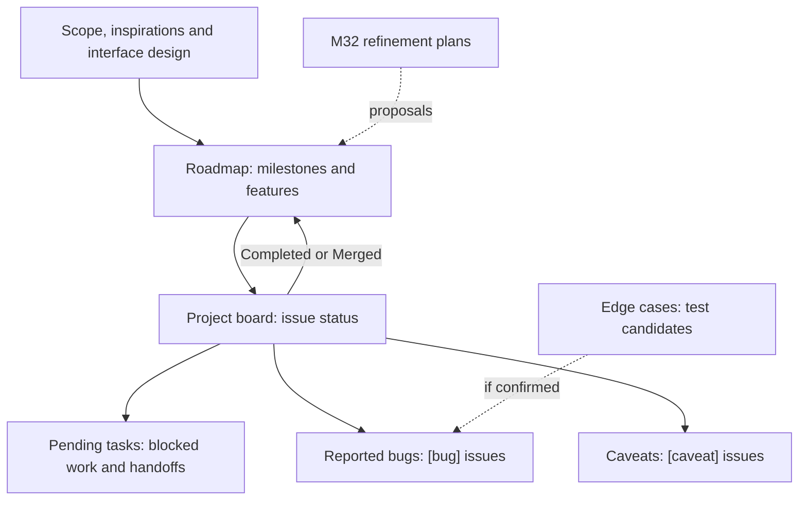

# Plasma Opus documentation

Find the right guide for using, building, planning and contributing to Plasma
Opus. Every document under `docs/` and the translation guide is listed here.

## Contents

- [User guides](#user-guides)
- [Planning and tracking](#planning-and-tracking)
- [Integrations](#integrations)
- [Behaviour references](#behaviour-references)
- [Contributor material](#contributor-material)

## User guides

How Plasma Opus works today and how to set it up.

| Guide                                | What it covers                                                  | Milestones                                                                                      |
| ------------------------------------ | --------------------------------------------------------------- | ----------------------------------------------------------------------------------------------- |
| [Project README](../README.md)       | Features, installation, customization and safety                | [M01–M26](ROADMAP.md#at-a-glance)                                                               |
| [Native tagging](tagging.md)         | Library format, tags, fields, search, backups and settings      | [M23](ROADMAP.md#m23-native-tagging)–[M24](ROADMAP.md#m24-tagging-settings)                     |
| [Yazi mode](yazi-mode.md)            | Per-pane column browsing, keys, what it keeps, persistence      | [M25](ROADMAP.md#m25-yazi-mode)–[M26](ROADMAP.md#m26-yazi-mode-settings)                        |
| [Translations](../po/README.md)      | Language settings, catalogue extraction, installation, fallback | [M13](ROADMAP.md#m13-translations)–[M14](ROADMAP.md#m14-translation-settings)                   |
| [Branding](BRANDING.md)              | Name, logo, icons, startup presentation and asset licensing     | [M19](ROADMAP.md#m19-branding)–[M20](ROADMAP.md#m20-branding-settings)                          |
| [Screenshots](screenshots/README.md) | Captured views and how they were made                           | Captured after [M18](ROADMAP.md#m18-theme-settings) and [M20](ROADMAP.md#m20-branding-settings) |

## Planning and tracking

The roadmap defines milestone scope and completion; the
[project board](https://github.com/users/mikepadiernos/projects/3) tracks issue
status. The other documents record what the board's issues leave open.

**Direction and plans**

| Document                                      | What it covers                                      |
| --------------------------------------------- | --------------------------------------------------- |
| [Scope and objective](philosophy/scope.md)    | Product direction and boundaries                    |
| [Inspirations](philosophy/inspirations.md)    | Sources and their influence                         |
| [Interface design](philosophy/designs.md)     | Target structure, panes, toolbars and workspaces    |
| [Roadmap](ROADMAP.md)                         | Architecture, milestone status and planned features |
| [M32 refinement plans](refinements/README.md) | Editable designs and proposed execution order       |

M32 refinement subsection plans

1. [Menus](refinements/01-menus.md)
2. [Layouts](refinements/02-layouts.md)
3. [Interaction](refinements/03-interaction.md)
4. [Settings](refinements/04-settings.md)
5. [Performance and startup](refinements/05-performance.md)
6. [Functional and security testing](refinements/06-testing.md)

**Status and tracking**

| Document                                                           | What it tracks                                   |
| ------------------------------------------------------------------ | ------------------------------------------------ |
| [Project board](https://github.com/users/mikepadiernos/projects/3) | Issue status from Backlog to Merged              |
| [Pending tasks](TODO.md)                                           | Blocked work and handoffs                        |
| [Reported bugs](BUGS.md)                                           | Bug reports and completion status                |
| [Caveats and limitations](CAVEATS.md)                              | Restrictions, dependencies and workarounds       |
| [Edge cases](EDGE.md)                                              | Potential boundary conditions and test scenarios |

> [!IMPORTANT]
> Refinement plans are proposals, pending tasks are handoffs, and edge cases are
> test candidates, not confirmed bugs. Development branches can contain work
> not yet on `main`.

## Integrations

These plans extend [M27](ROADMAP.md#m27-integrations),
[M28](ROADMAP.md#m28-integration-settings) and the Nextcloud milestones
[M29](ROADMAP.md#m29-nextcloud-integration) and
[M30](ROADMAP.md#m30-nextcloud-settings). Apart from the KDE foundations already
in use, they are not implemented.

| Plan                                                   | What it covers                                  |
| ------------------------------------------------------ | ----------------------------------------------- |
| [KDE Plasma](integrations/kde-plasma.md)               | Desktop integration plans and boundaries        |
| [Plasma Impresario](integrations/plasma-impresario.md) | Mail, calendar, notes and shared file workflows |
| [Nextcloud](integrations/nextcloud.md)                 | Nextcloud app workflows and considered features |

## Behaviour references

These inventories describe a reviewed Max File Manager checkout, not current
Plasma Opus behaviour or necessarily the latest upstream version. Plasma Opus
adapts the reference to KDE; use the roadmap for implementation status.

| Reference                                        | What it covers                                                                   |
| ------------------------------------------------ | -------------------------------------------------------------------------------- |
| [User interface](parity/ui.md)                   | Upstream layout, views, commands, dialogs, preference defaults and visual design |
| [Backend and file operations](parity/backend.md) | Upstream storage, modules, IPC surface and known quirks                          |

## Contributor material

| Document                                       | What it covers                                                                  |
| ---------------------------------------------- | ------------------------------------------------------------------------------- |
| [Development guide](development.md)            | Building, testing, dev container, conventions and project workflow              |
| [Project instructions](../CLAUDE.md)           | Authoritative conventions, project workflow, branches and issue handling        |
| [Release notes template](releases/TEMPLATE.md) | Starting point for GitHub release notes                                         |
| [Rust prototype](rust-prototype.md)            | M21 query-parser pilot, M23 tagging evaluation and criteria for later Rust work |
| [Qt Widgets and Qt Quick](qt-quick.md)         | Toolkit decision, Qt Quick embedding rules and criteria for candidates          |
| [Translations](../po/README.md)                | Extracting messages and updating language catalogues                            |
| [Screenshots](screenshots/README.md)           | Capture conditions and file names to keep when updating screenshots             |
