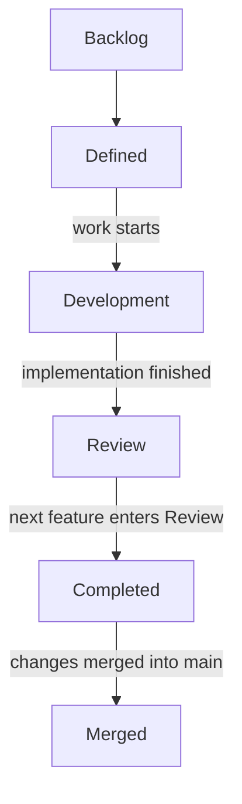

# Development guide

[](README.md)
[](../README.md)
[](ROADMAP.md)
[](https://github.com/users/mikepadiernos/projects/3)


How to build, test and contribute to Plasma Opus: build and test commands, the
headless dev container, optional mise tasks, formatting, code conventions and
the project workflow from issue to merge. To install Plasma Opus for everyday
use, see [Install](../README.md#install) in the project README.

> [!NOTE]
> The [project instructions](../CLAUDE.md) are the authoritative rules; this
> guide summarizes them. If the two disagree, follow the project instructions
> and update this guide.

## Contents

- [Requirements](#requirements)
- [Build and test](#build-and-test)
- [Dev container](#dev-container)
- [Development tooling](#development-tooling)
- [Formatting and checks](#formatting-and-checks)
- [Code conventions](#code-conventions)
- [Project workflow](#project-workflow)
- [Branches and commits](#branches-and-commits)
- [Bugs, caveats and pending work](#bugs-caveats-and-pending-work)
- [Releases](#releases)

## Requirements

Plasma Opus builds on Linux with:

- a C++20 compiler, CMake 3.25+ and Ninja;
- Qt 6.8+ with Jalali calendar support;
- Extra CMake Modules, libarchive and KDE Frameworks 6.20+.

See `CMakeLists.txt` for the required components and
[Development tooling](#development-tooling) for the versions used to
reproduce builds. Baloo development files optionally enable indexed search,
and libmpv with Qt OpenGL Widgets optionally enables embedded mpv playback.
Run `./install.sh --deps` to print the build and optional feature packages;
it does not install them. For runtime dependencies such as Konsole and
ExifTool, see [Optional integrations](../README.md#optional-integrations).

## Build and test

```bash
cmake -S . -B build -G Ninja -DCMAKE_BUILD_TYPE=Debug -DBUILD_TESTING=ON
cmake --build build
QT_QPA_PLATFORM=offscreen ctest --test-dir build --output-on-failure
./build/bin/opus-file-manager [path...]
```

Folders or URLs passed to the binary open as described in
[Arguments](../README.md#arguments).

| CMake option                 | Effect                                                                                                        |
| ---------------------------- | ------------------------------------------------------------------------------------------------------------- |
| `-DBUILD_TESTING=ON`         | Builds the QtTest suites in `tests/` for `ctest`                                                              |
| `-DOPUSFM_RUST_PROTOTYPE=ON` | Builds and tests the Rust query-parser prototype; off by default. See the [Rust prototype](rust-prototype.md) |

> [!TIP]
> If `build` was created before the project folder was renamed, use a fresh
> build directory.

## Dev container

On hosts without the Linux build dependencies, such as macOS, build and test in
the headless Docker dev container. It extends the `plasma-impresario-dev`
image, which `tools/dev-container/run.sh` builds from a sibling
`plasma-impresario` checkout, or from `IMPRESARIO_DIR`, when it is missing. Use
the separate `build-container` tree so it does not collide with a host build:

```bash
tools/dev-container/run.sh sh -c 'cmake -S . -B build-container -G Ninja -DCMAKE_BUILD_TYPE=Debug && cmake --build build-container'
tools/dev-container/run.sh ctest --test-dir build-container --output-on-failure -j4
```

Run `tools/dev-container/run.sh` without a command for an interactive shell,
or with `--rebuild` to rebuild the image. The repository is mounted at `/src`,
and ccache data persists between runs.

> [!IMPORTANT]
> The container has no Plasma session. Verify visual, KWin and Plasma
> integration behaviour on Plasma.

## Development tooling

[mise](https://mise.jdx.dev/) is optional. The root `mise.toml` pins CMake
and Ninja and wraps the commands above as tasks; the plain CMake workflow
needs no mise. After installing mise, trust the project's configuration once:

```bash
mise trust
mise run test                        # configure, build and run every suite
mise run test -R fileencryption      # extra arguments go to ctest
mise run container:test              # the same in the dev container
```

| Task                                                | Runs                                                             |
| --------------------------------------------------- | ---------------------------------------------------------------- |
| `configure`                                         | A Debug build with tests in `build`, once; Ninja reconfigures it |
| `build`                                             | `cmake --build build`                                            |
| `test`                                              | `ctest` headlessly with `QT_QPA_PLATFORM=offscreen`              |
| `format`                                            | The `clang-format` target                                        |
| `messages`                                          | The `extract-messages` target                                    |
| `run`                                               | `build/bin/opus-file-manager`, passing folders or URLs           |
| `container:configure`, `:build`, `:test`, `:format` | The same in the dev container, in `build-container`              |
| `container:shell`                                   | An interactive shell in the dev container                        |

mise installs only CMake and Ninja. The compiler, Qt, KDE Frameworks, Extra
CMake Modules, clang-format and the other libraries come from the system or
the dev container, because they must match the libraries Plasma Opus links
against. Builds are reproduced and tested with the dev container's Fedora 44
packages:

| Dependency                             | Required               | Dev container |
| -------------------------------------- | ---------------------- | ------------- |
| GCC                                    | Any with C++20 support | 16.2          |
| CMake                                  | 3.25+                  | 4.3.0         |
| Ninja                                  | Any                    | 1.13.2        |
| Qt                                     | 6.8+                   | 6.11.2        |
| KDE Frameworks and Extra CMake Modules | 6.20+                  | 6.32.0        |
| libarchive                             | Any                    | 3.8.7         |
| gettext                                | Any                    | 0.26          |
| clang-format                           | Any                    | 22.1          |

> [!TIP]
> clang-format versions can format the same code differently. Use
> `mise run container:format`, or the container command under
> [Formatting and checks](#formatting-and-checks), so formatting matches the
> commits.

## Formatting and checks

| Area        | How                                                                                                                                                                          |
| ----------- | ---------------------------------------------------------------------------------------------------------------------------------------------------------------------------- |
| C++         | Run `cmake --build build --target clang-format`, or the same target on `build-container` through `tools/dev-container/run.sh`. Configuring adds a formatting pre-commit hook |
| Markdown    | Follow `.markdownlint-cli2.yaml`: lines of at most 80 columns, except tables and code blocks                                                                                 |
| Translation | Extract messages with `scripts/extract-messages.sh`; see the [translation guide](../po/README.md)                                                                            |
| Screenshots | Keep the capture conditions and file names in the [screenshot notes](screenshots/README.md)                                                                                  |

## Code conventions

- **Layout:** put non-widget logic in `src/core/` and cover it with QtTest in
  `tests/`; put widgets in `src/app/`.
- **Toolkit:** build the interface with Qt Widgets; see
  [Qt Widgets and Qt Quick](qt-quick.md) for when Qt Quick may be embedded.
- **KDE first:** prefer KDE Frameworks facilities to custom implementations,
  including KIO jobs, KXmlGui actions, `KFileItemActions` and
  `KFilePlacesView`.
- **Strings:** localize user-visible text with `i18n()` or `i18nc()`.
- **Icons:** use Plasma's active icon theme through `QIcon::fromTheme()`. At 24
  logical pixels or smaller, prefer `-symbolic` variants through
  `SymbolicIcon::fromTheme()` or `SymbolicIcon::wrap()`.
- **Settings:** store settings in KConfig and session state through
  `KSharedConfig::openStateConfig()`.
- **Tests:** isolate tests from the real home folder, trash and configuration
  with `QTemporaryDir` and `QStandardPaths::setTestModeEnabled(true)`.

## Project workflow

The [roadmap](ROADMAP.md) defines milestones and features, and the
[project board](https://github.com/users/mikepadiernos/projects/3) tracks each
milestone's parent issue and its feature sub-issues. Items move forward through
six statuses and never move backward.



| Status      | When an item moves here                                                                                  |
| ----------- | -------------------------------------------------------------------------------------------------------- |
| Backlog     | It is recorded, but its milestone has not started                                                        |
| Defined     | Its milestone starts; the parent's start date is recorded                                                |
| Development | Work on it starts; its start date is recorded and the parent also moves to Development                   |
| Review      | Implementation is finished; its target date is set and it is checked in the parent issue                 |
| Completed   | The next feature in the milestone enters Review, or it is the last one; the issue is closed as completed |
| Merged      | Its changes are merged into `main`; it stays closed as completed                                         |

> [!IMPORTANT]
> A roadmap feature is checked only when its issue is **Completed** or
> **Merged**, never while it is in Review. Every roadmap item ends with a link
> to its board issue, such as `[#752]`. When all of a milestone's feature items
> are checked, the parent's target date is set.

## Branches and commits

- **Milestones** are developed in `feature/M##-name` branches, such as
  `feature/M27-integrations`. A milestone merges into `main` only when it is
  feature-complete.
- **Bugs and caveats** are fixed in their own branches and merged into `main`
  when fixed.
- **Documentation-only changes** use short-lived `docs/…` branches merged
  through a pull request.
- **Commits** are grouped by scope and use Conventional Commit prefixes such as
  `feat`, `fix`, `test`, `docs`, `build` and `chore`, with an optional scope:
  `docs(roadmap): add Luciole-inspired M28 and M32 items`. Reference issues as
  `GH752` or `(#752)`.

## Bugs, caveats and pending work

| Kind         | Issue title and label        | Record in                | Notes                                                                                     |
| ------------ | ---------------------------- | ------------------------ | ----------------------------------------------------------------------------------------- |
| Bug          | `[bug] …`, label `bug`       | [Reported bugs](BUGS.md) | Link the report and issue both ways; update the status when it changes                    |
| Caveat       | `[caveat] …`, label `caveat` | [Caveats](CAVEATS.md)    | Describe the limitation and a recommendation; post the recommendation as an issue comment |
| Blocked task | Existing issue or milestone  | [Pending tasks](TODO.md) | Record the blocker, confirmed state and steps to resume; link it from the roadmap         |
| Edge case    | None until confirmed         | [Edge cases](EDGE.md)    | A possible scenario to test, not a confirmed bug                                          |

Every bug and caveat issue is added to the project board. Bug and caveat
issues stay open until they are resolved, even after a related milestone
merges.

## Releases

Start release notes from the [release notes template](releases/TEMPLATE.md).
Published releases are listed on the
[releases page](https://github.com/mikepadiernos/plasma-opus/releases).

---

[Documentation index](README.md) · [Project README](../README.md) ·
[Project instructions](../CLAUDE.md)
