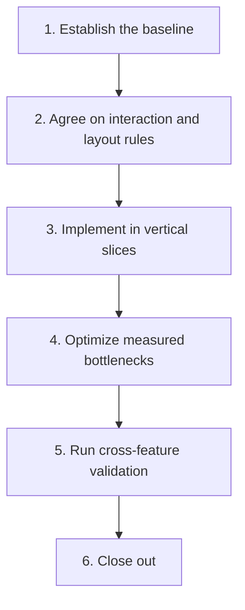

# M32 Refinements

Editable plans for [M32 Refinements](../ROADMAP.md#m32-refinements): menus,
layouts, interaction, settings, performance and testing, guided by the
[interface design](../philosophy/designs.md).

> [!IMPORTANT]
> These are proposals for review, not implementation or completion
> reports. The roadmap defines scope; the issue and board track status.
> Reconcile accepted scope changes with the roadmap and issues; plan text alone
> does not change their status.

Before starting, check issue and board state and follow the
[project workflow](../../CLAUDE.md#project-workflow).

## Contents

- [Plans](#plans)
- [Proposed execution order](#proposed-execution-order)

## Plans

Each plan follows the same structure: **Problem**, **Proposal**, **Execution
order** (with issue references) and **Open questions**.

| #   | Plan                                             | Covers                                                                   | Roadmap                                 | Status                                                                      |
| --- | ------------------------------------------------ | ------------------------------------------------------------------------ | --------------------------------------- | --------------------------------------------------------------------------- |
| 1   | [Menus](01-menus.md)                             | Menu and context-menu organization, action state, toolbar discovery      | [M32.01](../ROADMAP.md#m32-refinements) |  |
| 2   | [Layouts](02-layouts.md)                         | Five-region layout, defaults, toolbar customization, restore and scaling | [M32.02](../ROADMAP.md#m32-refinements) |  |
| 3   | [Interaction](03-interaction.md)                 | Accessibility, pane context, states, confirmations, help and motion      | [M32.03](../ROADMAP.md#m32-refinements) |  |
| 4   | [Settings](04-settings.md)                       | Settings navigation, search, validation, defaults and persistence        | [M32.04](../ROADMAP.md#m32-refinements) |  |
| 5   | [Performance and startup](05-performance.md)     | Startup, settings and build-time measurement; Rust evaluation            | [M32.05](../ROADMAP.md#m32-refinements) |  |
| 6   | [Functional and security testing](06-testing.md) | Coverage matrix, end-to-end, accessibility, security, sanitizers and CI  | [M32.06](../ROADMAP.md#m32-refinements) |  |

## Proposed execution order

1. **Establish the baseline:** inventory existing workflows, tests,
   customizations and dependencies; measure startup and settings performance.
   Record the environment and known limitations before changing behaviour. See
   [testing](06-testing.md) and [performance](05-performance.md).
2. **Agree on interaction and layout rules:** map action ownership, pane
   context, defaults, accessibility and existing customizations. Review these
   choices together before changing menus, layouts or controls.
3. **Implement in vertical slices:** start with action state and menus, then
   layout and toolbar customization, followed by interaction and settings.
   Coordinate shared action, help and customization work across the plans;
   include focused tests in each slice rather than waiting until the end.
4. **Optimize measured bottlenecks:** compare with the baseline, apply startup
   and settings improvements, and evaluate Rust only for suitable measured core
   hotspots. The M21 pilot can inform the decision but is not a reason to block
   unrelated refinements if unavailable.
5. **Run cross-feature validation:** execute the functional, accessibility,
   environment and security plan; investigate findings, retest changes and
   document remaining issues. Testing cannot prove the absence of defects.
6. **Close out:** verify each feature, then follow the
   [project workflow](../../CLAUDE.md#project-workflow) and record blockers or
   caveats as required.

The order is a recommendation, not a requirement to serialize independent work.
Cross-cutting design and testing should happen throughout. Review currently
implemented features first; unavailable later features do not block M32 and
should be revisited when they ship.
