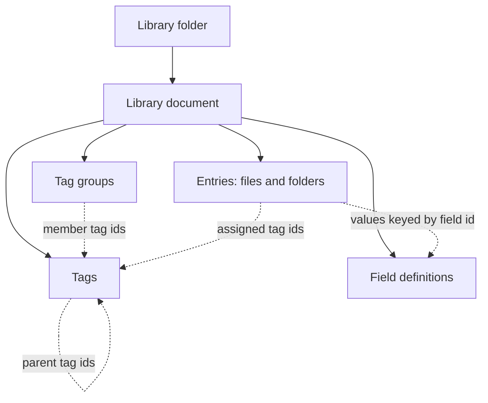

# Native tagging

[](README.md)
[](ROADMAP.md#m23-native-tagging)
[](ROADMAP.md#m24-tagging-settings)
[](CAVEATS.md#native-tagging)
[](CAVEATS.md#tagging-settings)


This guide explains how to organize files with tag libraries (M23), how to
configure them in **Preferences › Tagging** (M24), and documents the open
library format for other tools.

> [!IMPORTANT]
> Libraries are opt-in and only describe your files. Plasma Opus never moves,
> renames or duplicates the files it indexes. A file itself changes only when
> you write embedded metadata into it, after a preview and your confirmation.

## Contents

- [Overview](#overview)
- [Getting started](#getting-started)
- [Tagging files](#tagging-files)
- [Managing tags](#managing-tags)
- [Fields](#fields)
- [Searching by tags and metadata](#searching-by-tags-and-metadata)
- [Embedded metadata](#embedded-metadata)
- [Managing libraries](#managing-libraries)
- [Export, backup and restore](#export-backup-and-restore)
- [Settings](#settings)
- [Library format](#library-format)
- [Privacy](#privacy)

## Overview

Tag libraries are inspired by [TagStudio], but Plasma Opus doesn't need it. A
library is rooted at an existing local folder and stores tags, tag groups,
text and date fields and file entries in one open JSON document. There are no
per-file sidecars.

The implementation is C++ in `src/core/`; see the
[Rust evaluation](rust-prototype.md#m23-tagging-evaluation) for why.

### Concepts

| Concept       | What it is                                                                                                                                                     |
| ------------- | -------------------------------------------------------------------------------------------------------------------------------------------------------------- |
| **Library**   | An existing local folder registered with Plasma Opus, and the one document that holds its metadata. Libraries can't be nested.                                 |
| **Tag**       | A label with a stable identifier, a name that may repeat, and optional aliases, shorthand, colour and parent tags. See [Managing tags](#managing-tags).        |
| **Tag group** | A named, ordered set of tags, such as _People_ or _Places_, that organizes how tags are listed. See [Tag groups](#tag-groups).                                 |
| **Field**     | A text or date value stored on items alongside their tags, such as a _Title_ or the date a photo was _Shot on_. See [Fields](#fields).                         |
| **Entry**     | An indexed file or folder, recorded by its path relative to the library folder, with its tags and field values. See [Managing libraries](#managing-libraries). |

Everything in a library document refers to tags, groups and fields by
identifier, so renaming one never breaks a reference:



## Getting started

1. Open the folder you want to organize and choose **Tags › Create Library
   from Folder…**. After you confirm, the folder becomes a library and a first
   refresh indexes its contents. See
   [Creating and removing libraries](#creating-and-removing-libraries).
2. Select some items and choose **Tags › Assign Tags…**, also in their
   context menu. The tag panel opens with the keyboard focus in its search
   field.
3. Type a tag name and press <kbd>Enter</kbd>. A tag whose name, alias or
   shorthand matches exactly is assigned or removed; otherwise a new tag with
   that name is created and assigned.
4. Use **Tags › Manage Tags…** to add aliases, colours, parent tags, groups
   and fields.
5. Find tagged items with a query such as `tag:holiday` in **Search**, or
   select them with **Edit › Select › Select by Query…**.
6. Adjust indexing, search and import behaviour in
   [**Preferences › Tagging**](#settings).

## Tagging files

**Tags › Tag Panel** shows the tag panel to the right of or below the panes.
Its options menu, dragging its title bar or **Show the tag panel** in
Preferences moves it, and the choice is kept in the `TagPanelPlacement`
setting. A placement remembered by an earlier version is moved into the
setting the first time a window opens. **Assign Tags…**, in the Tags menu and
the context menu of items in a library, shows the panel and moves the keyboard
focus to its search field.

The panel lists the tags of the library that contains the selected items.
Each tag's check box shows whether it is assigned to all of them, some of
them (partly checked) or none:

- Checking a tag assigns it to every selected item; clearing it removes it
  from every selected item.
- Items that aren't indexed yet, such as files added since the last refresh,
  are indexed when they are tagged.
- With nothing selected, the panel shows the tags of the library containing
  the current folder.
- When the library has [tag groups](#tag-groups), tags are listed under their
  groups.

### Keyboard use

- Type in the search field to filter tags by name, alias or shorthand.
- Press <kbd>Enter</kbd> to assign or remove the tag whose name, alias or
  shorthand matches exactly, or to create a tag with the typed name and
  assign it.
- Press <kbd>Down</kbd> to move to the list, then <kbd>Space</kbd> or
  <kbd>Enter</kbd> to assign or remove the current tag.

### What can be tagged

Tags can only be assigned within one library. The panel explains why when the
selection includes items in different libraries, items outside any library,
the library folder itself, symbolic links or remote items, and shows the
current folder's tags without check boxes.

### Tags in the Information panel

The Information panel shows a **Tags** row for items in a library, unless
**Show the tags of the selected item** is off. It lists the tags assigned
directly; its tooltip lists the tags they inherit from their parents. With
**List tags inherited from parent tags** on, the inherited tags also follow
the direct ones in the row, each marked **(inherited)**.

## Managing tags

**Tags › Manage Tags…** lists the tags of the library containing the active
folder. The list can be searched by name, alias and shorthand, and shows each
tag's colour, parents and the number of items it is assigned to.
Edits are saved to the library document straight away; a read-only library can
be browsed but not changed.

Each tag has:

- a stable identifier, so renaming a tag keeps its assignments, parents and
  group memberships;
- a name, which is required and may repeat;
- aliases, one per line, that also find the tag. Repeated aliases and aliases
  that match the tag's name are dropped;
- an optional shorthand without spaces;
- an optional colour. **Give new tags a colour** in the
  [Tags tab](#tags-tab) preselects one for new tags;
- parent tags. Items with a tag also match `tag:` searches for its parents and
  their parents, unless **Match child tags in tag: searches** is off.

### Duplicate names

Tags may share a name, ignoring case, such as _Jaguar_ the animal and _Jaguar_
the car. Plasma Opus always refers to tags by identifier, and shows a shared
name followed by the first of these that tells the tags apart: the tag's
parents, its shorthand or the start of its identifier. The tag editor shows
how a new or renamed tag will appear before it is saved.

### Hierarchy

A tag can have several parents, but the hierarchy can't contain cycles. In
the tag editor, the tag itself and the tags below it can't be chosen as
parents. Libraries written by other tools that contain cycles are repaired
when they are loaded, as described in
[Reading and writing](#reading-and-writing).

### Deleting tags

Deleting a tag asks for confirmation and says how many items and child tags
it affects. The tag is removed from those items, from its child tags' parents
and from tag groups; child tags keep their other parents. No files are
changed.

### Tag groups

Tag groups organize how a library's tags are listed, for example _People_,
_Places_ and _Projects_. They are part of the library, so they are shared by
every window and workspace, and they don't depend on the current location or
workspace. Groups don't change what items are tagged with or what searches
match.

The **Groups** tab of **Manage Tags…** lists the groups in display order:

- **New Group…** and **Edit…** set a group's name, an optional colour and its
  tags. The tag list can be filtered by name, alias or shorthand. A tag can be
  in several groups, and group names may repeat.
- **Move Up** and **Move Down** change the order of the groups.
- **Delete…** asks for confirmation and removes only the group; its tags and
  their assignments are kept.

Groups have stable identifiers, so renaming a group or its tags keeps its
members. The **Tags** tab shows each tag's groups.

When a library has groups, the tag panel lists every group in order with its
tags below it, followed by **Other Tags** for tags that aren't in a group. A
tag in several groups appears under each, and checking any copy assigns it.
No group is hidden unless a search in the panel matches neither its name nor
any of its tags; searching for a group's name shows all of its tags. Libraries
without groups show a flat list.

## Fields

Fields store text or a date on items in a library alongside their tags, for
example a _Title_ or the date a photo was _Shot on_. They are kept in the
library document; files and their labels, ratings and notes aren't changed.

### Defining fields

The **Fields** tab of **Manage Tags…**, and the
[Fields tab](#fields-tab) in Preferences, list the library's fields with
their type and the number of items that have a value:

- **New Field…** and **Edit…** set a field's name and type, **Text** or
  **Date**. Field names must be unique, ignoring case.
- A field's type can't be changed while any item has a value for it, because
  values aren't converted between types.
- **Delete…** asks for confirmation, says how many items have a value and
  removes the field with its values.

New libraries can start with a set of fields; see
[Fields for New Libraries](#fields-tab).

### Editing field values

**Edit Fields…**, in the Tags menu and the context menu of items in a
library, edits the values of the selected items. It has one row per field:

- Text fields accept any text up to 10,000 characters.
- Date fields are written as `YYYY-MM-DD`; the calendar button picks a date.
  Invalid dates, such as `2026-02-30`, are refused before anything is saved.
- When the selected items have different values, the row shows **Several
  values**. Only the rows you edit are applied, so the other values are kept.
- Clearing a row removes that value from every selected item.

Items that aren't indexed yet are indexed when a value is set. Like tags,
fields can only be edited within one library; the status bar explains why
when the selection can't be edited. When a library has no fields, the editor
offers **Manage Fields…**.

The Information panel shows a **Fields** row for items in a library that has
fields, with one `Name: value` line per value. Dates are shown in the regional
format.

## Searching by tags and metadata

Advanced queries, in **Search** and in **Edit › Select › Select by Query…**,
accept tag and embedded-metadata criteria alongside the name, path, type,
size, modified and content criteria, and combine them with `AND`, `OR`, `NOT`
and parentheses.

### Query syntax

| Criterion          | Matches                                                                                                                |
| ------------------ | ---------------------------------------------------------------------------------------------------------------------- |
| `tag:Animal`       | Items in a library with a tag whose name, an alias or shorthand² is `Animal`, ignoring case, or one of its child tags¹ |
| `tag=Animal`       | Items in a library with such a tag assigned directly, not through a child tag                                          |
| `tag:ani*`         | Items in a library with a tag whose name, an alias or shorthand² matches the wildcard pattern, or one of its children¹ |
| `tagged:yes`       | Items in a library with at least one tag; `tagged:true` is the same                                                    |
| `tagged:no`        | Items in a library with no tags, including items that aren't indexed yet; `tagged:false` is the same                   |
| `meta:canon`       | Files with an embedded property that contains `canon`, ignoring case                                                   |
| `meta=Jazz`        | Files with an embedded property that is exactly `Jazz`, ignoring case                                                  |
| `meta:20*`         | Files with an embedded property that matches the wildcard pattern                                                      |
| `A B` or `A AND B` | Items matching both criteria                                                                                           |
| `A OR B`           | Items matching either criterion                                                                                        |
| `NOT A` or `-A`    | Items not matching the criterion                                                                                       |
| `( … )`            | Groups criteria                                                                                                        |

¹ Child tags only match while **Match child tags in tag: searches** is on in
the [Tags tab](#tags-tab).

² Aliases and shorthands only match while **Match tag aliases and
shorthands** is on in the [Search tab](#search-tab).

- `tags:` is accepted for `tag:`, and `metadata:` for `meta:`. Field names
  and `tagged:` values ignore case, but `AND`, `OR` and `NOT` must be
  written in capitals.
- In wildcard patterns, `*` matches any characters and `?` one character.
  Quote a value to match `*` and `?` literally, as in `tag:"what?"`. With
  `=`, a pattern such as `tag=ani*` matches directly assigned tags only.
- Tag, `tagged:` and metadata criteria can't use `<`, `<=`, `>` or `>=`.

For example, `tag:holiday type:image/* NOT tag:private` finds holiday images
that aren't private, and `tagged:no type:file` finds files still to be
tagged.

### How tag criteria match

Tag criteria only match items inside a registered library. Outside a library,
none match, and `tagged:no` only does while **Include items outside libraries
in tagged:no searches** is on in the [Search tab](#search-tab);
`NOT tagged:yes` includes items outside libraries either way.

- Entries whose file is missing are treated as untagged, because a different
  file may now be at their path.
- The library document itself is never a result.
- A search reads each library once, so changes made while it runs aren't
  reflected in its results.

A search of the current folder with tag criteria covers only that folder,
unless **Search tags in** is **The whole library** in the
[Search tab](#search-tab); then it covers the library that contains the
folder.

### Searching embedded metadata

`meta:` criteria match the [embedded properties](#embedded-metadata) Plasma
Opus reads, in any library or folder, except those turned off in the
[Embedded Metadata tab](#embedded-metadata-tab). With every property off,
`meta:` criteria match nothing and files aren't read for them.

Each value of a list, such as one keyword, is matched on its own, and dates
are also matched as `YYYY-MM-DD`, so `meta:2024-05*` finds photos taken in
May 2024. Like `content:`, metadata criteria read each candidate file, so
they're checked after cheaper criteria; combine them with a name or type
criterion, as in `type:image/* meta:canon`, to keep searches fast. Live and
indexed searches and **Select by Query…** use the properties read when they
start.

### Select by Query and indexed search

**Select by Query…** and **Deselect by Query…** apply a query to the items
listed in the active pane, or to every shown item in flat view. They support
local folders only and can't use `content:` criteria; use Search to find text
within files. `meta:` criteria work there, but read every listed file before
the selection changes, so they can be slow in large folders.

Indexed search still needs a name or content term, such as `report tag:work`.

## Embedded metadata

Images and audio files carry metadata of their own, such as the camera and
date of a photo or the artist and genre of a song. Plasma Opus reads it with
KDE's metadata extractors, the same ones that feed Baloo and the Information
panel:

- From images: date taken, date, camera make and model, title, description,
  subject, keywords, artist, copyright, ISO, f-number, exposure time and focal
  length.
- From audio files: title, artist, album artist, album, genre, composer, year,
  track and disc number and comment.

Reading never changes the file, and a file that can't be read is reported
rather than treated as empty. Properties turned off in the
[Embedded Metadata tab](#embedded-metadata-tab) aren't read for searches or
imports, and the preview panel and gallery don't show them. To search these
properties, see [Searching embedded metadata](#searching-embedded-metadata).

### Importing into a library

**Import Embedded Metadata…**, in the Tags menu and the context menu of items
in a library, copies embedded properties of the selected files into the
library:

1. The files are read in the background. The dialog then lists the properties
   that were found, with example values, under **Import As**. Only the
   properties read in the [Embedded Metadata tab](#embedded-metadata-tab) are
   read and listed; when some or all are turned off and nothing is found, the
   dialog says so.
2. Choose **Tags** or a field for each property, or leave it at **Don't
   import**. Each property starts with its saved choice when the library has
   a suitable field of that name; otherwise a field with the same name as the
   property is suggested. Lists, such as keywords, become one tag per value,
   and dates can go to date fields.
3. **Preview** lists every change per item: tags to assign, tags to create,
   values to set or replace, values already imported, and values that are
   skipped because they're invalid or conflict. Nothing is written yet.
4. **Import** applies the preview. Tags with a matching name, alias or
   shorthand are reused rather than created again, and importing the same
   files twice changes nothing. A successful import saves the choices of the
   listed properties, by field name, as the
   [saved mappings](#embedded-metadata-tab); **Don't import** removes a saved
   choice, and the choices of properties that weren't listed are kept.

By default, a field that already has a different value keeps it, and the
preview shows it as a conflict. Check **Replace existing field values** to
overwrite them; **Different field values** in the settings chooses whether it
starts checked. If a value changes in the library between the preview and the
import, the newer value is kept and the status bar says so. A read-only
library can be previewed but not imported into.

### Importing on refresh

With **Import the metadata of new items when a library is refreshed** on,
manual and automatic [refreshes](#indexing) also import the files they add,
without a preview:

- After the refresh is saved, the mapped properties of the new files are read
  in the background, and the saved mappings are resolved against the library
  and applied with the **Different field values** setting.
- Mappings to fields the library doesn't have, or whose type can't hold the
  property, are skipped.
- Folders, files indexed by earlier refreshes and files found again at their
  recorded path aren't imported; import those with **Import Embedded
  Metadata…**.
- The refresh dialog adds a line such as **Imported embedded metadata for 3
  items.**, and automatic refreshes add **imported embedded metadata for 3
  items** to their status bar message.
- Canceling the refresh dialog while it reads imports nothing.

### Writing metadata into files

An import only changes the library document. To change the metadata stored
in a file itself, use **File › Edit Metadata…**, or **Edit Embedded
Metadata…** in the import dialog when a single JPEG, TIFF or MP3 file is
selected. It previews the new values and writes the file only after you
confirm.

The import dialog's button is disabled until you allow writing to files in
the [Privacy tab](#privacy-tab); **File › Edit Metadata…** isn't affected.

## Managing libraries

### Creating and removing libraries

Libraries are opt-in. **Tags › Create Library from Folder…** asks for
confirmation and then registers the active folder as a library root:

- Registered roots are stored in the `Tag Libraries` group of the Plasma Opus
  configuration. `LibraryRegistry` in `src/core/libraryregistry.h` manages
  them.
- When the folder has no library document, an empty one is created in the
  place chosen in the [Privacy tab](#privacy-tab). A valid existing document
  is adopted where it is, so tags survive removing and creating a library
  again; an unreadable one is reported and left unchanged. When an existing
  document isn't where the setting asks, the confirmation and the status bar
  say so.
- Libraries can't be nested: a folder inside a library, or a folder that
  contains one, can't become a library.
- Creating a library runs a first [refresh](#indexing).

**Tags › Remove Library…** unregisters the library that contains the active
folder after confirmation. Its document is kept and no files are deleted.

The [Libraries tab](#libraries-tab) in Preferences lists every library and
can add and remove libraries or move a library's metadata between the
library folder and private storage. The Tags menu and Preferences ask the
same questions, from `LibraryConfirmations` in
`src/app/libraryconfirmations.h`.

### Unsupported and read-only locations

`TagLibrary::checkLocation()` reports locations that can't hold a library:

- remote and other non-local locations, and relative paths;
- missing paths, files and symbolic links;
- the file system root;
- folders that can't be read.

A library whose document can't be written opens read-only. For a document in
the folder, that is a folder on a read-only file system or without write
permission, or a document that can't be written. For a private document, only
the private folder and the document count, so a folder you can read but not
write can still hold a writable private library. A read-only library's tags
can still be shown and searched, but edits are refused with a message.
Creating a library in a read-only folder is refused unless its metadata is
stored privately.

### Indexing

A refresh walks the library root in the background with progress and can be
canceled. `LibraryScan` in `src/core/libraryscan.h` implements it. Refreshing
only reads the file system: nothing is moved, renamed, copied or written
except the library document.

- Files and folders of every type are indexed, including hidden ones unless
  [**Index hidden files and folders**](#libraries-tab) is off. An item is
  hidden when any part of its path below the root starts with `.`.
- Items matching an exclusion pattern, and items deeper than the folder depth
  limit, are neither indexed nor looked into.
- A refresh indexes at most the item limit set in Preferences. A refresh that
  reaches it stops, records what it found and marks nothing missing, and its
  summary says so.
- Symbolic links are not indexed, and linked folders are not followed, so a
  library never reaches outside its root or loops.
- `.mfm.json` files and the library document are skipped.
- Names that aren't valid in the system encoding are skipped and counted in
  the summary, because they can't be stored as UTF-8 paths.
- New paths become entries, and known paths have their size, modification
  time and identity hints updated.
- Entries that a complete refresh doesn't find are marked `missing` and keep
  their tags and fields. A canceled refresh, one stopped by the item limit,
  or one where some folders couldn't be read, records what it found but marks
  nothing missing.
- Entries that the exclusions, hidden items setting or depth limit put out of
  scope are left as they are: they keep their tags and fields and aren't
  marked missing. Tagging an excluded item explicitly, or moving it in Plasma
  Opus, still indexes it.
- A missing entry found again at its recorded path is no longer missing.
- When the [Embedded Metadata tab](#embedded-metadata-tab) imports on
  refresh, the embedded metadata of the new files is then imported, as
  described in [Importing on refresh](#importing-on-refresh).

**Tags › Refresh Library** and **Tags › Review Missing Entries…** act on the
library containing the active folder. The refresh summary offers **Review
Missing Entries…** when entries are missing.

### Automatic refresh

Libraries can also be refreshed automatically, as set in the
[Libraries tab](#libraries-tab). `LibraryAutoRefresh` in
`src/app/libraryautorefresh.h` refreshes one library at a time in the
background for all windows, with the same scope and limits, and reports added
and missing entries and errors briefly in the status bar of the active window.
It records each library's last refresh in the `LibraryRefresh` group of the
state configuration, skips a library refreshed within the interval, and gives
way to a manual refresh of the same library. Refreshes in progress are
canceled when Plasma Opus quits.

### Moves and renames in Plasma Opus

Moves and renames that Plasma Opus starts keep their tags and fields: moving
or cutting and pasting, dropping, renaming in the rename dialog, renaming
inline in the cards view, and batch renaming. `LibraryMoveTracker` follows
them and `LibraryMoves` in `src/core/librarymoves.h` applies them.

- A move is applied only once it is confirmed on disk: the destination has
  the renamed item's device and inode, or, for KIO moves, the source is gone
  and the destination exists. Skipped, failed and canceled items aren't
  applied.
- Entries below a moved folder move with it, and swapped names are applied
  together.
- An entry at an overwritten destination is replaced. When a folder is merged
  into an existing folder, neither folder's tags are replaced: the moved
  folder's entry is kept as missing if both have tags or fields.
- Moving an item out of a library marks its entries missing, and moving an
  item into a library indexes it without tags. Tags aren't copied between
  libraries.
- Copies, and moves and renames made by other programs, aren't followed.
  The next refresh marks the old paths missing for review.

### Reviewing missing entries

**Review Missing Entries** lists the entries the last refresh didn't find,
with their tag and field counts. For the selected entry it suggests indexed
items of the same kind that have no tags or fields and either the same device
and inode, or the same name and, for files, the same size. Suggestions are
only shown; metadata moves only when you choose one:

- **Relink to Suggestion** attaches the entry to the selected suggestion.
- **Choose Item…** attaches it to a file or folder you pick inside the
  library. Symbolic links and items outside the library are refused.
- **Forget Entry…** removes the entry and its tags and fields after
  confirmation. No files are deleted.

Relinking never overwrites an entry that has tags or fields. Relinking a
folder also relinks the missing entries inside it.

## Export, backup and restore

**Export Library Metadata…** and **Restore Library Metadata…**, in the Tags
menu, save a library's tags, groups, fields and entries to a file and bring
them back later. Both only read or write the export and the library document;
the files in the library are never changed, copied, moved or deleted.

### Exporting

The export dialog summarizes what will be exported and suggests a file such as
`Photos library 2026-11-25.json` in your Documents folder. It only replaces an
earlier export: other files, symbolic links and files named
`.opus-library.json` are refused. If the library changes while the dialog is
open, the summary is updated and you export again. The file is plain JSON; see
[Export format](#export-format).

### Restoring

Restoring replaces the library document as a whole:

1. Choose an export, or a copy of a library document, and **Preview** it. The
   preview lists the tags, groups and fields that are restored, removed or
   changed, and the items whose tags or field values change, with the
   library's counts now and after restoring. Nothing is written yet.
2. Check **Replace the library's current tags, groups, fields and item
   metadata**, then **Restore**. Choosing another file clears the preview and
   the confirmation.

Items are matched by their path inside the library, so an export can be
restored into a library that has moved. Entries whose file or folder isn't at
its path any more are restored as missing, so
[Review Missing Entries](#reviewing-missing-entries) can relink them. A
library document that is missing or can't be read can be restored too.

The restore is refused, without writing, when the library changed after the
preview or its document can't be written. A private library is restored in
place, so nothing is written to its folder. Exports from newer versions of
Plasma Opus are refused rather than restored partially.

### Backups

Before writing, a restore copies the previous library document to the backup
folder set in the [Privacy tab](#privacy-tab). By default this is
`~/.local/share/opus-file-manager/library-backups/` (below `$XDG_DATA_HOME`
when that is set). The status bar names the copy; restore it like an export
to undo.

Copies are named after the folder, the time and the first eight characters of
the library's hash, such as `Photos 2026-11-25 100000 1a2b3c4d.json`. After a
restore, the oldest copies of that library beyond **Keep at most … backups
per library** are deleted. Only regular files named like that library's copies
are considered. Copies that record another library folder, copies made before
Plasma Opus added the hash to the name, and any other file are never deleted.

## Settings

**Preferences › Tagging** holds the tagging settings in six tabs. They are
stored in the `Tagging` group of the Plasma Opus configuration under the keys
shown below.

### Privacy tab

The tab starts by explaining what Plasma Opus stores; see [Privacy](#privacy).

| Setting                                                        | Key                           | Default               | Effect                                                                                                                                                                                                                                                            |
| -------------------------------------------------------------- | ----------------------------- | --------------------- | ----------------------------------------------------------------------------------------------------------------------------------------------------------------------------------------------------------------------------------------------------------------- |
| **Store metadata of new libraries**                            | `NewLibraryStorage`           | In the library folder | Where **Create Library from Folder…** creates the document of a new library: **In the library folder**, or **Privately, in Plasma Opus's data folder**. Existing documents are adopted where they are. See [Where libraries are kept](#where-libraries-are-kept). |
| **Backup folder**                                              | `LibraryBackupFolder`         | Empty                 | Where restores keep a copy of the replaced library document. Empty uses `library-backups` in Plasma Opus's data folder, shown as the placeholder.                                                                                                                 |
| **Keep at most … backups per library**                         | `LibraryBackupLimit`          | 20                    | How many copies of each library a restore keeps, from 0 (**All**) to 1000. See [Backups](#backups).                                                                                                                                                               |
| **Allow writing library values into files' embedded metadata** | `AllowEmbeddedMetadataWrites` | Off                   | Enables **Edit Embedded Metadata…** in the import dialog. Plasma Opus always previews the changes and asks before changing a file.                                                                                                                                |

### Libraries tab

The tab lists the registered libraries with their folder, where their
metadata is kept (**Library folder** or **Private**) and their state:
**Ready**, **Read-only**, or the reason the library can't be used, such as a
missing folder or an unreadable document.

- **Add Library…** picks a local folder and asks the same question as
  **Tags › Create Library from Folder…**. A new document follows **Store
  metadata of new libraries** as currently shown in the Privacy tab and starts
  with the [fields for new libraries](#fields-tab), and an existing one is
  adopted where it is. The new library then gets its first refresh in the
  background.
- **Remove…** unregisters the selected library after confirmation. Its
  document is kept and no files are deleted.
- **Keep Metadata Privately** or **Keep Metadata in Library Folder**, as fits
  the selected library, moves its document after confirmation. See
  [Where libraries are kept](#where-libraries-are-kept).

These changes take effect immediately, even if Preferences is canceled, and
open windows update their tag panel and Information panel.

| Setting                             | Key                       | Default | Effect                                                                                                                                                                                                                             |
| ----------------------------------- | ------------------------- | ------- | ---------------------------------------------------------------------------------------------------------------------------------------------------------------------------------------------------------------------------------- |
| **Exclude**                         | `LibraryExclusions`       | Empty   | Wildcard patterns, one per entry, of items refreshes don't index or look into. `*` matches any characters and `?` one; case matters. Without `/`, a pattern matches names at any depth, such as `node_modules`, `*.tmp` or `.git`. |
| **Index hidden files and folders**  | `IndexHiddenItems`        | On      | When off, refreshes skip items with any part of their path starting with `.`.                                                                                                                                                      |
| **Index at most … items**           | `LibraryScanLimit`        | 0       | The most items one refresh indexes, up to 10,000,000; 0 shows **No limit**. A refresh that reaches it marks nothing missing.                                                                                                       |
| **Folder depth**                    | `LibraryScanDepth`        | 0       | How many folder levels below the library folder are indexed, up to 1000; 1 indexes only its direct contents, and 0 shows **No limit**.                                                                                             |
| **Refresh libraries automatically** | `AutomaticLibraryRefresh` | Never   | **Never**, **When Plasma Opus starts**, which refreshes every library once shortly after the first window appears, or **When a folder in the library is opened** in the active pane.                                               |
| **At most once every … minutes**    | `LibraryRefreshInterval`  | 60      | From 1 to 10,080 minutes. Libraries refreshed more recently, also by a quick restart or a manual refresh, aren't refreshed automatically. Disabled when automatic refresh is **Never**.                                            |

A pattern with `/` matches the path below the library folder, such as
`Archive/Old` or `Exports/*`; there `*` and `?` don't match `/`. A trailing
`/` matches folders only. Items inside an excluded folder are excluded too.
Scope settings apply only to refreshes: entries already indexed keep their
tags and fields, as described in [Indexing](#indexing).

### Tags tab

| Setting                                  | Key                          | Default      | Effect                                                                                                                                                                                                                  |
| ---------------------------------------- | ---------------------------- | ------------ | ----------------------------------------------------------------------------------------------------------------------------------------------------------------------------------------------------------------------- |
| **Show the tag panel**                   | `TagPanelPlacement`          | On the right | **On the right** or **Below the panes**. The panel's own menu and dragging it change the setting too.                                                                                                                   |
| **Show tag and group colours**           | `ShowTagColors`              | On           | When off, the tag panel, **Manage Tags…** and the tag and group editors' lists show a plain tag icon instead of colour swatches, for groups too. Colours stay stored and can still be edited.                           |
| **Give new tags a colour**               | `DefaultTagColor`            | Off          | A colour, stored as `#rrggbb`, for tags created in the tag panel, with **New Tag…** in **Manage Tags…** and by metadata imports. Off, or a stored value that isn't `#rrggbb`, creates tags without a colour.            |
| **Show the tags of the selected item**   | `ShowTagsInInformationPanel` | On           | Shows the **Tags** row in the Information panel. Library field values are shown either way.                                                                                                                             |
| **List tags inherited from parent tags** | `ShowInheritedTags`          | Off          | Lists inherited tags after the item's own tags in the **Tags** row, marked **(inherited)**; the tooltip lists them either way. Disabled while the row is hidden.                                                        |
| **Match child tags in tag: searches**    | `TagMatchesChildTags`        | On           | When off, `tag:` matches only items with a tag it names, as `tag=` does, in searches and **Select by Query…**. Searches already running keep the setting they started with. Filtering in the tag panel is not affected. |

Applying the tab moves the tag panel and updates the tag panel and an open
**Manage Tags…** dialog in the window Preferences was opened from. Other
windows show colour and Information panel changes when those panels next
refresh, and move their tag panel when they are opened again. Searches use
the setting from when they start.

### Search tab

| Setting                                                   | Key                                | Default            | Effect                                                                                                                                                                                                                                                                                                    |
| --------------------------------------------------------- | ---------------------------------- | ------------------ | --------------------------------------------------------------------------------------------------------------------------------------------------------------------------------------------------------------------------------------------------------------------------------------------------------- |
| **Search tags in**                                        | `TagSearchScope`                   | The current folder | **The current folder** or **The whole library**. With the whole library, a search of the current folder whose query has `tag:`, `tag=` or `tagged:` criteria starts in the deepest library folder that contains the current folder, and the finished status says **Searched the whole tag library in …**. |
| **Match tag aliases and shorthands**                      | `TagMatchAliases`                  | On                 | When off, `tag:` and `tag=` match tag names only, also with wildcards, in searches and **Select by Query…**.                                                                                                                                                                                              |
| **Include items outside libraries in tagged:no searches** | `UntaggedIncludesOutsideLibraries` | Off                | When on, `tagged:no` also matches items outside every library, in searches and **Select by Query…**. `tagged:yes` and `tag:` still don't match them, and library documents and library folders themselves never match.                                                                                    |

**Search tags in** only widens searches of the current folder, live or
indexed with a depth limit; path filters and the depth limit then count from
the library folder. Indexed searches without a depth limit already cover the
whole index. Search folders, workspace searches and **Select by Query…**,
which works on the listed items, are not affected, and neither are queries
without tag criteria or folders outside libraries. A library folder that is
missing or a symbolic link isn't searched from; the search stays in the
current folder.

Searches already running keep the settings they started with. Child tags
follow **Match child tags in tag: searches** in the [Tags tab](#tags-tab).

### Fields tab

**Library Fields** manages the fields of one library at a time. Choose it
under **Library**, which lists the registered libraries and follows libraries
added or removed in the Libraries tab; without libraries, the tab says how to
add one. The list below works like the **Fields** tab of **Manage Tags…**:
**New Field…**, **Edit…** and **Delete…** save to the library's metadata
immediately, even if Preferences is canceled, and open windows update their
Information panel. A library whose metadata can't be read shows why, and a
read-only one can be viewed but not changed. See [Fields](#fields).

| Setting                      | Key                | Default | Effect                                                                                                                                                                                                                                    |
| ---------------------------- | ------------------ | ------- | ----------------------------------------------------------------------------------------------------------------------------------------------------------------------------------------------------------------------------------------- |
| **Fields for New Libraries** | `NewLibraryFields` | Empty   | The fields, with their type, that a library starts with when **Create Library from Folder…** or **Add Library…** creates its metadata, in the order listed. **Add…**, **Edit…**, **Remove**, **Move Up** and **Move Down** edit the list. |

Field names must be unique, ignoring case. The list is stored as `text:Name`
or `date:Name` entries; entries without a known type or a valid name, and
repeated names, are ignored. Existing libraries aren't changed, and neither is
existing metadata that a library adopts when its folder is added again.
**Add Library…** uses the list as currently shown, even before it is applied.

### Embedded Metadata tab

**Properties to Read** lists every [embedded property](#embedded-metadata)
under **Images**, **Audio**, and **Images and Audio** for those both are read
from, such as title and artist. Checking or clearing a heading changes all of
its properties. **Importing into Libraries** has a table with one row per
property that is read; its **Import As** choice offers **Not imported**,
**Tags** or **Field “Name”**.

| Setting                                                          | Key                               | Default              | Effect                                                                                                                                                                                                                                                                          |
| ---------------------------------------------------------------- | --------------------------------- | -------------------- | ------------------------------------------------------------------------------------------------------------------------------------------------------------------------------------------------------------------------------------------------------------------------------- |
| **Properties to Read**                                           | `DisabledEmbeddedMetadataKeys`    | All checked          | Unchecked properties aren't read or shown: `meta:` criteria in searches and **Select by Query…** ignore them, the preview panel and gallery hide them, **Import Embedded Metadata…** doesn't list them and refreshes don't import them. Stored as KFileMetaData property names. |
| **Import As**                                                    | `EmbeddedMetadataMappings`        | Not imported         | The saved mapping of each property: **Tags**, or a field chosen by name. **Import Embedded Metadata…** starts with it and saves the choices it imports with. Stored as entries such as `genre=tags` or `model=field:Camera`.                                                    |
| **Different field values**                                       | `EmbeddedMetadataConflicts`       | Keep existing values | **Keep existing values** or **Replace existing values**, for fields that already have a different value: whether **Replace existing field values** starts checked in the import dialog, and what refreshes do.                                                                  |
| **Import the metadata of new items when a library is refreshed** | `ImportEmbeddedMetadataOnRefresh` | Off                  | Imports the files a refresh adds with the saved mappings, without a preview. See [Importing on refresh](#importing-on-refresh). Disabled, with a hint, until a property that is read has a mapping.                                                                             |

The fields offered are the union of the fields of every registered library
and the [fields for new libraries](#fields-tab) as currently shown, each name
once, ignoring case; date fields are offered only for date properties. A
saved field name that no library has yet is still shown. Because mappings
name fields rather than identify them, one mapping works for every library:
when importing, the field is found by name in that library, ignoring case,
and skipped if it is missing or its type can't hold the property. Properties
that aren't read keep their mappings, hidden, but don't count for importing on
refresh. Entries for unknown properties or without a valid target are ignored.

> [!WARNING]
> Searches, imports and refreshes already running keep the settings they
> started with. An import dialog that is open when Preferences is applied, or
> Preferences open while an import saves its choices, can overwrite the
> other's mappings when it saves.

## Library format

A library is one document. By default it is the file `.opus-library.json` at
the library root. A library can instead keep it privately in Plasma Opus's
data folder, so nothing is written to the library folder, which suits shared
drives and read-only folders; see
[Where libraries are kept](#where-libraries-are-kept). There are no per-file
sidecars, and the format is plain UTF-8 JSON that other tools can read and
write. `TagLibrary::Library` in `src/core/taglibrary.h` implements it.

```json
{
  "format": "plasma-opus-library",
  "version": 1,
  "tags": [
    { "id": "…", "name": "Animal", "color": "#336699" },
    {
      "id": "…",
      "name": "Cat",
      "aliases": ["Kitty"],
      "shorthand": "c",
      "parents": ["<Animal id>"]
    }
  ],
  "groups": [{ "id": "…", "name": "Subjects", "tags": ["<tag id>"] }],
  "fields": [{ "id": "…", "name": "Shot on", "type": "date" }],
  "entries": [
    {
      "id": "…",
      "path": "photos/cat.jpg",
      "kind": "file",
      "size": 12345,
      "modified": 1764072000000,
      "device": "2049",
      "inode": "1234567",
      "tags": ["<Cat id>"],
      "fields": { "<field id>": "2026-02-28" }
    }
  ]
}
```

| Key       | Meaning                                                                                                                  |
| --------- | ------------------------------------------------------------------------------------------------------------------------ |
| `format`  | Always `plasma-opus-library`.                                                                                            |
| `version` | The format version. Version 1 readers refuse higher versions rather than risk losing data.                               |
| `tags`    | Tags with a stable `id`, a `name`, optional `aliases`, `shorthand`, `color` (`#rrggbb`) and `parents` (tag identifiers). |
| `groups`  | Tag groups with a stable `id`, a `name`, an optional `color` and member `tags` in display order.                         |
| `fields`  | Field definitions with a stable `id`, a `name` and a `type` of `text` or `date`.                                         |
| `entries` | Indexed files and folders.                                                                                               |
| `root`    | Private documents only: the library folder the document belongs to. It is ignored when the document is read.             |

Identifiers are opaque strings; Plasma Opus creates UUIDs. Names may repeat,
so other data always refers to tags, groups and fields by identifier.

### Entries

Each entry has:

- `id`: a stable identifier that survives renames and relinking.
- `path`: the path relative to the library root, with `/` separators. It is
  never absolute and never contains `.` or `..` components.
- `kind`: `file` or `folder`.
- `size` and `modified`: the size in bytes and the modification time in
  milliseconds since the epoch, recorded at the last refresh.
- `device` and `inode`: decimal strings recorded at the last refresh. They are
  hints for relinking only; metadata is never attached to a file because its
  inode matches.
- `missing`: `true` when the last refresh didn't find the file.
- `tags` and `fields`: assigned tag identifiers, and field values keyed by
  field identifier. Date values use `YYYY-MM-DD`.

### Where libraries are kept

`TagLibrary::documentPath()` finds the document of a library:

- A private document is
  `~/.local/share/opus-file-manager/libraries/<hash>.json` (below
  `$XDG_DATA_HOME` when that is set). `<hash>` is the hexadecimal SHA-1 of
  the library folder's cleaned path in UTF-8. The `libraries` folder is
  created readable only by you.
- When a private document exists for a folder, it is used; otherwise the
  library is `.opus-library.json` in the folder.

**Store metadata of new libraries** in the [Privacy tab](#privacy-tab)
chooses where **Create Library from Folder…** creates the document. An
existing document is always adopted where it is, so a library never ends up
with two: a private document first, then one in the folder.
`TagLibrary::moveDocument()` moves a document between the two places. It
checks the document, writes it atomically to the target, reads it back and
only then deletes the original. It refuses to replace an existing document and
touches no other file.

> [!NOTE]
> A private document is keyed by the folder's path. When a library folder is
> moved or renamed, its private document isn't found at the new path. Create
> the library again at the new path and use **Restore Library Metadata…** with
> an export or with the old private document; copies of library documents are
> accepted. The old private document is left in place.

### Reading and writing

- Unknown top-level keys are preserved when Plasma Opus saves a library.
  Unknown keys inside tags, groups, fields and entries are not.
- Invalid structure, such as duplicate identifiers or paths, unsafe paths or
  wrong types, makes the whole document unreadable instead of being guessed
  at.
- Dangling references, invalid colours or dates and parent cycles are
  repaired when the library is loaded and reported as warnings; the document
  on disk changes only when the library is next saved.
- Saves are atomic: the document is written to a temporary file next to it
  and renamed into place. This applies to private documents too.
- A private document also records the library folder under `root`. The key
  is dropped when the document is read, so it never reaches exports.
- A save is refused when the document changed on disk since it was loaded,
  for example from another window. Edits are applied to a freshly loaded copy
  and retried, so concurrent edits aren't lost.

### Existing metadata

Libraries don't read, convert or replace the per-folder `.mfm.json` files that
hold labels, colours, ratings, notes, pins and view formats. Both kinds of
metadata can exist in the same folder. Refreshes skip `.mfm.json` and the
library document itself.

### Export format

An [export](#export-backup-and-restore) is plain JSON that wraps the library
document:

```json
{
  "format": "plasma-opus-library-export",
  "version": 1,
  "exported": "2026-11-25T10:00:00Z",
  "root": "/home/user/Photos",
  "library": { "format": "plasma-opus-library", "version": 1, "…": "…" }
}
```

## Privacy

The [Privacy tab](#privacy-tab) starts by explaining what Plasma Opus stores:

- A library's metadata holds its tags, aliases, shorthand, colours and groups;
  its field definitions and values; the indexed items' paths relative to the
  library folder, with size, modification time and file system identity
  numbers; and which items have which tags.
- The list of library folders is kept in the configuration, and backups are
  kept in the backup folder.
- Nothing is sent over the network.
- Files themselves only change when you write embedded metadata.

Where this data lives:

| Data                         | Location                                                                                                                                                    |
| ---------------------------- | ----------------------------------------------------------------------------------------------------------------------------------------------------------- |
| Library metadata             | `.opus-library.json` in the library folder, or a private document readable only by you. See [Where libraries are kept](#where-libraries-are-kept).          |
| Registered library folders   | The `Tag Libraries` group of the Plasma Opus configuration.                                                                                                 |
| Last automatic refresh times | The `LibraryRefresh` group of the state configuration.                                                                                                      |
| Backups made by restores     | The backup folder, by default `library-backups` in Plasma Opus's data folder. See [Backups](#backups).                                                      |
| Exports                      | Only where you save them. A private document's `root` key never reaches exports.                                                                            |
| Embedded metadata in files   | Unchanged unless you write it with **File › Edit Metadata…**, or with **Edit Embedded Metadata…** after allowing writes in the [Privacy tab](#privacy-tab). |

[TagStudio]: https://github.com/TagStudioDev/TagStudio
